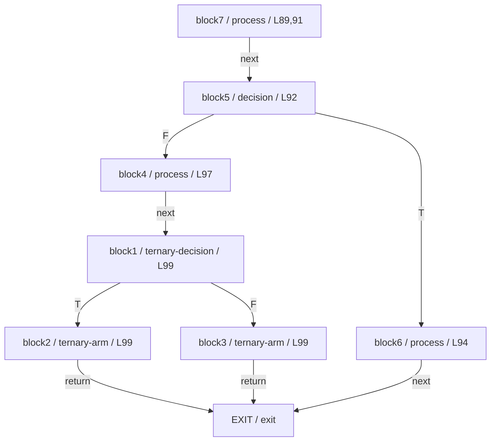
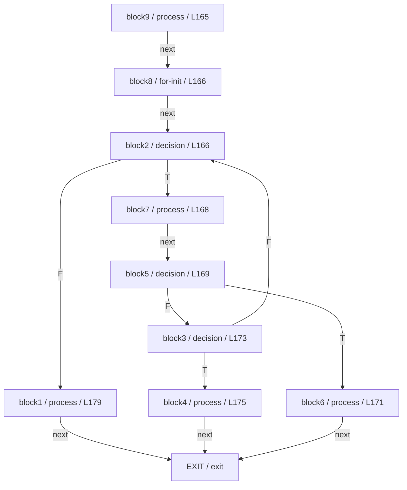
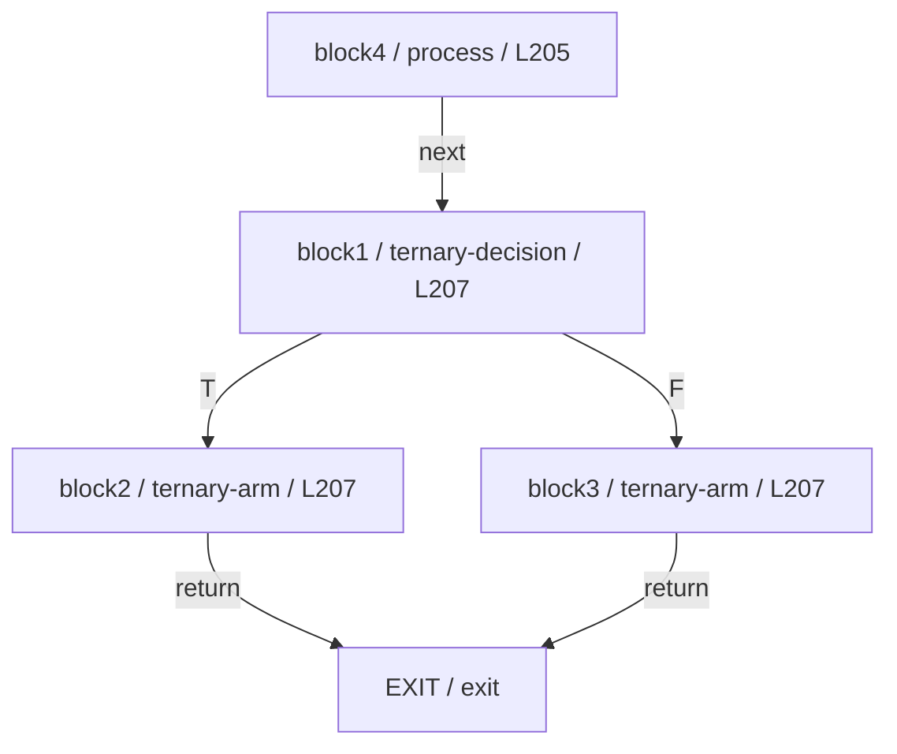

# CFG จาก source จริงของ Cli-1

กราฟระดับ source decisions ภายในแต่ละเมธอด แสดง normal control flow; ไม่ใช่ exception/path coverage และไม่ขยาย call edges ไปยังเมธอดอื่น Synthetic exit ไม่นับเป็น block

Source SHA-256: `4000f382a138b952dbfc784318dbff32d21219c6b04ca5f22ee37396da944d35`

## CommandLine#getOptionObject(String)

| Node | Source lines | Counted |
|---|---|---|
| EXIT |  | False |
| block1 | 99 | True |
| block2 | 99 | True |
| block3 | 99 | True |
| block4 | 97 | True |
| block5 | 92 | True |
| block6 | 94 | True |
| block7 | 89,91 | True |

## CommandLine#resolveOption(String)

| Node | Source lines | Counted |
|---|---|---|
| EXIT |  | False |
| block1 | 179 | True |
| block2 | 166 | True |
| block3 | 173 | True |
| block4 | 175 | True |
| block5 | 169 | True |
| block6 | 171 | True |
| block7 | 168 | True |
| block8 | 166 | True |
| block9 | 165 | True |

## CommandLine#getOptionValue(String,String)

| Node | Source lines | Counted |
|---|---|---|
| EXIT |  | False |
| block1 | 207 | True |
| block2 | 207 | True |
| block3 | 207 | True |
| block4 | 205 | True |

