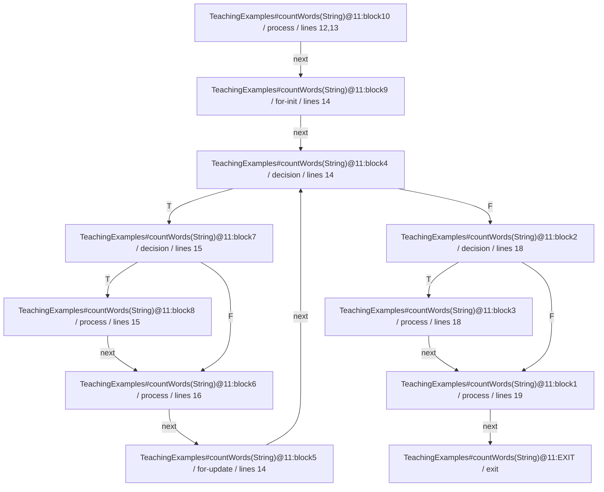

# CFG ตัวอย่าง countWords

ขอบเขต: source-level decisions ของเมธอดใน tests/golden/TeachingExamples.java

กราฟนี้มี 10 counted blocks และ synthetic exit ที่ไม่นับ ตัวเลข decision coverage มาจาก 3 decisions × 2 outcomes ไม่ใช่จำนวน edges ทั้งกราฟ

สำหรับ input `cats|dogs` ได้ block 10/10 และ decision 5/6; outcome ที่ยังไม่เกิด:

- `TeachingExamples#countWords(String)@11:decision3:F`
